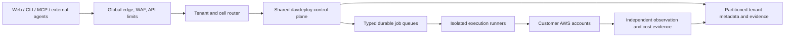

# Scale and multi-tenancy goal

## Goal

davdeploy is being designed to support millions of customer identities over time without turning every customer into a bespoke deployment. The goal is not to provision million-customer infrastructure now. The goal is to make the boundaries that determine future scale explicit before implementation hardens around a single tenant, single queue, single database, or single execution process.

## Current implementation checkpoint

The local product now has versioned tenant/evidence/model/job/usage contracts, a durable
PostgreSQL queue seam, a provider-neutral model gateway, typed planning evidence, fail-closed
execution contexts with cell/region placement, tenant-scoped entitlements, and deterministic
planner regression scenarios. These are the scale seams we can validate locally before paying
for a distributed hosted topology.

They are not a claim that the current single-process Compose stack serves millions of customers.
Hosted scale still requires production identity, durable RDS operations, partitioning/cell
routing, quota storage, worker autoscaling, live provider evidence, and load/failure testing.

## Scale dimensions

Capacity must be measured separately for:

- active users and concurrent sessions;
- planning/model requests;
- GitHub webhook and repository events;
- AWS discovery requests;
- Terraform/GitOps execution jobs;
- telemetry, audit and evidence events;
- connected accounts, projects and environments;
- billing and usage records.

Registered-user count alone is not a capacity model.

## Target control-plane shape

## Invariants to implement now

1. Every request, record, job, artifact, metric and audit event carries organization/workspace/project/environment scope.
2. Model output is never execution authority.
3. Execution is isolated from the API process and uses short-lived credentials.
4. Job transport is replaceable: PostgreSQL locally, managed queues when load requires them.
5. Provider, model, pricing, policy and execution adapters are versioned interfaces.
6. Submitted plans and evidence are immutable; new knowledge creates a new revision.
7. Customer data is retained, exported and deleted according to explicit policy.
8. Tenant routing can later select a region/cell without changing business contracts.

## Scale evolution

### Local and early hosted

- Modular FastAPI application.
- RDS PostgreSQL.
- Database-backed worker queue.
- App Runner or ECS/Fargate.
- Single AWS region.
- Deterministic fixture providers plus read-only live adapters.

### Growth

- SQS/EventBridge-backed typed queues.
- Separate planning, integration, execution and observation workers.
- Read models and cache for dashboards.
- Usage metering, quotas and entitlements.
- Tenant-aware rate limits and concurrency controls.
- Cell metadata and regional routing.

### Large-scale and enterprise

- Multiple control-plane cells and regional data boundaries.
- Pooled, bridge and silo tenant isolation tiers.
- Private outbound execution agents for restricted networks.
- Cross-region recovery and tenant migration.
- Enterprise identity, retention, audit export and compliance operations.

## Architecture and cost decision record

This section records the intended direction for a large DavDeploy service. It
is planning guidance, not a claim that the current hosted control plane has
that capacity.

### First customers: keep the existing inexpensive shape

For roughly 100 users, use the current managed/serverless control plane:

- Cloudflare Pages for the browser application.
- API Gateway HTTP API and Lambda for the API and asynchronous worker.
- Aurora PostgreSQL Serverless v2 with `min_capacity = 0`, a small maximum,
  encryption, backups and deletion protection.
- Cognito Essentials for identity; SQS for durable background work; S3 for
  artifacts; SES/Resend for email.
- One AWS Region, a single database cell, and the existing rate limits,
  alarms, audit events and least-privilege customer connection model.

Do not add ECS, EKS, Redis, read replicas, a second Region, Kafka, NAT-heavy
private service networking, or per-customer accounts before measured demand
justifies them. These would increase fixed cost and operational burden without
improving the first-customer experience.

An indicative shared-platform estimate at this size is **$15–$50/month in
AWS**, excluding AI/model calls and customer workloads. It assumes light use,
Aurora pauses while idle, Cognito remains within its included MAU tier, and
email remains within provider allowances. It is a planning range, not a bill:
region, database active time, logs, retention, email volume and model traffic
can change it. Customer infrastructure must remain billed to the customer's
cloud account.

### Aurora availability decision

The initial Aurora Serverless v2 configuration is `min_capacity = 0` and
`max_capacity = 2`. It can pause after idle time and eliminates database
compute charges while paused. The first request after a pause can take roughly
15 seconds or longer to establish a database connection.

Keep this cost-optimised setting while the control plane is lightly used. When
real customer evidence shows that first-use latency is unacceptable, set the
minimum to **0.5 ACU**. This keeps the database warm and removes the
auto-resume delay, at an indicative US East compute cost of about
**$43.80/month** at 0.5 ACU continuously, plus database storage and related
AWS services. At the current observed early-use level, that is roughly
$35–$40/month more than the paused configuration.

This decision does **not** require an ECS migration. Keep API and worker
functions on Lambda for early customers. Investigate one provisioned Lambda
concurrency only if measured Lambda cold starts become a separate customer
experience problem. ECS Fargate remains a growth-stage decision for sustained
traffic, long-running work, or worker-concurrency pressure.

### Growth trigger: containers only when evidence requires them

Move API and worker processes to separate ECS Fargate services only when
Lambda/Data API latency, sustained worker concurrency, long-lived work, or
connection pressure is demonstrated. Retain managed Cognito, SQS, S3,
EventBridge, Aurora, CloudWatch and the customer-account execution boundary.
Use an Application Load Balancer, RDS Proxy, two or more API tasks across two
Availability Zones, and queue-depth worker scaling at that point.

### Large scale: regional cells, not one global database

At very large scale, route each workspace to a home regional cell. A cell has
its own API/worker capacity, queue and Aurora database boundary. The global
directory maps a workspace to its cell; business records, plans, audit events
and execution data remain within that assigned cell. This reduces the blast
radius and permits measured regional expansion.

Use a warm recovery Region before attempting active-active writes. Add read
replicas, cache, additional cells, private customer runners, and stronger
enterprise isolation only in response to measured needs and contractual
requirements. No customer browser, model, agent or shared API process receives
unrestricted customer-cloud authority at any stage.

## Product moat

The scalable asset is not only the API fleet. It is the customer-specific infrastructure evidence graph: repository facts, inventory, policies, plans, approvals, observed resources, incidents, costs and outcomes. It must be tenant-scoped, provenance-aware and portable across model providers and execution backends.

## Non-goals for the current phase

- No Kafka or Kubernetes control plane merely for appearance.
- No active/active multi-region deployment before usage and recovery requirements justify it.
- No per-customer VPC or account by default.
- No autonomous remediation of protected production environments.
- No foundation-model training.
